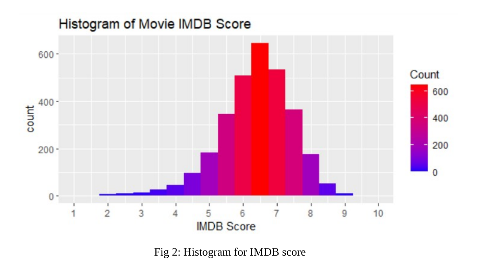
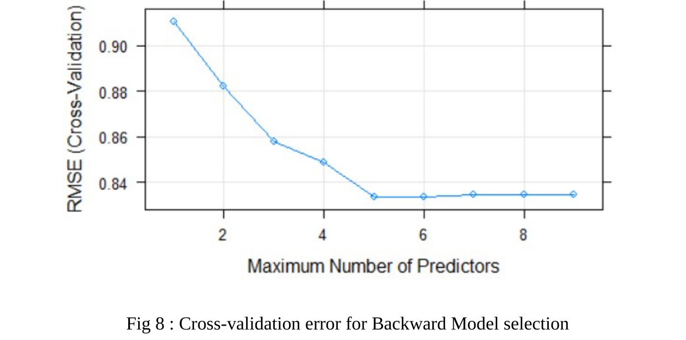
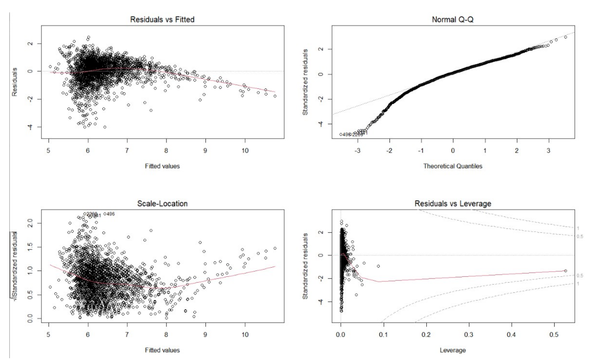

# Predicting IMDB Movie Ratings

Final project for **MATH 6333 Statistical Learning, Fall 2022, University of Texas Rio Grande Valley** (instructor: Dr. Hansapani Rodrigo).

**Team:** Dipok Deb · Orune Aminul · Areefin-Ul-Hassan Chowdhury

## Key Results

| Model | Headline result |
|---|---|
| **Linear regression** (6 predictors) | Test MSE **0.6296133**; cross-validated RMSE ≈ **0.833–0.834** |
| **Random forest** (rating binarised at 5) | Test error **8.6%**; best out-of-bag error **7.79%** (mtry 12) |

- **Data:** 5,043 movies cleaned down to **3,015 US movies, 16 predictors**; 80/20 split (2,414 train / 601 test)
- **Response:** `imdb_score`, range **1.6–9.3**; 148 movies scored above 8, only 4 above 9
- **Strongest predictors:** critic reviews (`num_critic_for_reviews`), audience votes (`num_voted_users`), `duration`, and `budget` — the best linear model uses `num_critic_for_reviews`, `duration`, `actor_1_facebook_likes`, `num_voted_users`, `budget`, and `title_year`

## Goal

Can a movie's IMDB rating be predicted from information available before or around its release — critic reviews, duration, cast popularity, budget and year? This project compares linear regression (with variable selection) against a random-forest classifier on the IMDB 5000 Movie Dataset.

## Data

- **Source:** IMDB 5000 Movie Dataset, Kaggle — see [`data/README.md`](data/README.md)
- **Raw data:** 5,043 movies, 28 variables, spanning 1916–2016 and 66 countries
- **Response:** `imdb_score` (range 1.6–9.3; 148 movies scored above 8, only 4 above 9)
- **Cleaning:** dropped ~11 variables, kept USA movies only, removed missing values → **3,015 movies, 16 predictors**
- **Split:** 80% train (2,414) / 20% test (601)

*Figure 1 — Distribution of `imdb_score`: most films cluster between 6 and 7.5, with a long tail of low-rated films.*

## Methods

- **Exploratory analysis:** distributions and correlations with `imdb_score` (strongest: `num_voted_users`, `num_critic_for_reviews`, `duration`, `budget`/`gross`)
- **Linear regression** with backward, forward and best-subset selection; residual diagnostics on the best model
- **Random forest classification:** `imdb_score` binarised (< 5 vs ≥ 5), predictors with information value < 0.05 dropped; out-of-bag error compared across mtry 1–12

*Figure 2 — Cross-validated RMSE for backward selection: error flattens at about 0.833 once the model reaches 5–6 predictors, so the 6-variable model was selected.*

## Results

- **Best linear model** (6 variables: `num_critic_for_reviews`, `duration`, `actor_1_facebook_likes`, `num_voted_users`, `budget`, `title_year`): cross-validated RMSE ≈ 0.833–0.834, **test MSE 0.6296133**
- **Random forest:** best out-of-bag error **7.79%** (mtry 12), **test error 8.6%**
- **Conclusion:** the random forest performed well on this data set; the linear model gives an interpretable baseline, with critic reviews and audience votes among the strongest predictors of a film's rating

*Figure 3 — Residual diagnostics for the best linear model (Residuals vs Fitted, Normal Q-Q, Scale-Location, Residuals vs Leverage).*

## How to Run

No analysis code is included in this repository — the R script was not among the files supplied, so the report is the record of the analysis. To reproduce it:

1. Download `movie_metadata.csv` from the Kaggle link in [`data/README.md`](data/README.md).
2. In R, apply the cleaning steps from the report: drop the ~11 variables listed there, keep USA movies only, and remove rows with missing values (→ 3,015 movies, 16 predictors).
3. Split 80/20 (2,414 train / 601 test), then fit the linear models with backward, forward and best-subset selection (the report uses `regsubsets` and `car::vif`) and the random-forest classifier with `imdb_score` binarised at 5.
4. Compare against the numbers in [Key Results](#key-results) above — the full write-up is in `report/STAT_FINAL_PROJECT_V2.pdf`.

## Files

| Path | Contents |
|---|---|
| `report/STAT_FINAL_PROJECT_V2.docx` | Full final report (Word, newest and most complete version, Dec 11 2022) |
| `report/STAT_FINAL_PROJECT_V2.pdf` | PDF export of the report (GitHub cannot preview .docx) |
| `slides/final_presentation_stat_learning.pptx` | Final presentation deck (~25 slides) |
| `images/histogram-imdb-score.png` | Figure 1 — distribution of IMDB scores |
| `images/cv-rmse-backward-selection.png` | Figure 2 — cross-validated RMSE, backward selection |
| `images/residual-diagnostics.png` | Figure 3 — residual diagnostics for the best linear model |
| `data/README.md` | Data source link (no data file committed) |

## Notes

- **No analysis code is included.** The R script for this project was not among the files supplied — only the report and slides. If the original script turns up, it belongs in a `code/` folder.
- **Small inconsistency in the original documents (left as-is):** the report gives the best linear model's test MSE as **0.6296133**, while the slides give **0.618**; the report lists 6 variables in the best model, while the slides describe 7 predictors with 6 significant (`actor_1_facebook_likes` dropped on p-value). The graded documents were not edited — the report's figures are used above.
- **References cited in the report:** Bristi et al. (2019); Gaenssle et al. (2018); Saraee et al. (2004).

## License

MIT — see [LICENSE](LICENSE).
